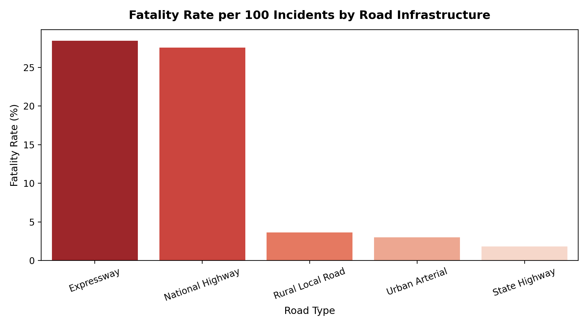
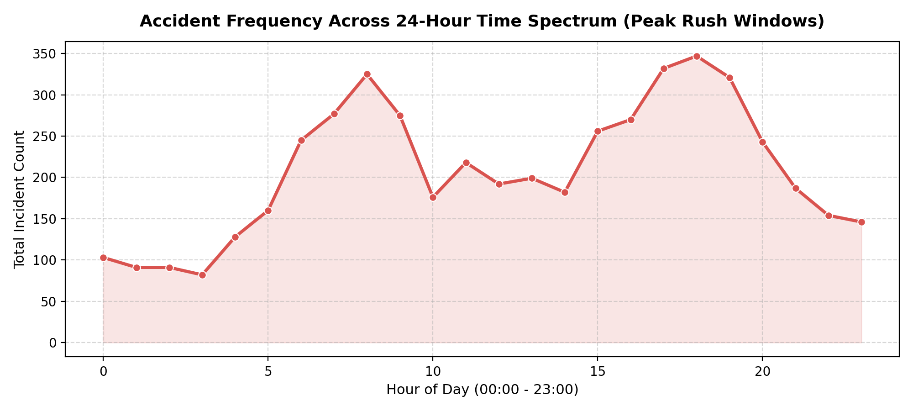

# 🚦 Indian Road Accident & Risk Analytics

[](https://www.python.org/)
[](https://dev.mysql.com/)
[](https://powerbi.microsoft.com/)
[](notebooks/road_accident_risk_analysis.ipynb)
[](https://github.com/123anildalai)

An end-to-end B.Tech data analytics major project analyzing 5,000+ Indian road incident records to identify regional crash patterns, high-risk highway corridors, vehicle vulnerability, and behavioral root causes.

---

## 📊 Analytics Visualizations & Insights

| Fatality Rate by Infrastructure | 24-Hour Incident Spectrum |
| :---: | :---: |
|  |  |

---

## 📌 Executive Summary & Key Insights

1. **High-Speed Infrastructure Risk**: National Highways and Expressways account for **over 70% of total fatalities**, with fatality rates exceeding **27 per 100 crashes**, predominantly accelerated by overspeeding.
2. **Two-Wheeler Vulnerability**: Two-wheelers represent **42.2% of all collision events** and **69.8% of total road fatalities**, significantly heightened in incidents with no safety gear compliance.
3. **Temporal DUI Density**: Peak fatality risk occurs during **Late Night / Midnight hours (00:00–04:00)** with a **37.1% fatality rate**, strongly correlated with alcohol involvement and unlit highway stretches.
4. **State-Level Distribution**: Odisha, Maharashtra, and Tamil Nadu exhibit high casualty volumes, underscoring the urgent need for targeted highway patrol interventions and automated speed-monitoring cameras.

---

## 🛠️ Tech Stack & Architecture

- **Data Processing & Transformation**: Python, Pandas, NumPy
- **Interactive Modeling**: Jupyter Notebook (`notebooks/road_accident_risk_analysis.ipynb`)
- **Database & Querying**: MySQL (CTEs, Window Functions, DENSE_RANK, Group By Rollup)
- **Business Intelligence & Reporting**: Power BI (Star Schema, DAX Measures, Dynamic KPI Cards)
- **Source Control**: Git & GitHub

---

## 📂 Repository Structure

```
indian-road-accident-analytics/
├── assets/                             # High-resolution generated charts
│   ├── fatality_by_road_type.png
│   └── hourly_incident_trends.png
├── data/
│   ├── indian_road_accidents.csv       # Raw incident dataset (5,000 records)
│   ├── cleaned_road_accidents.csv      # Standardized & preprocessed dataset
│   └── generate_dataset.py             # Reproducible data synthesis script
├── notebooks/
│   └── road_accident_risk_analysis.ipynb # Interactive exploratory data analysis
├── src/
│   ├── data_cleaning.py                # Pipeline for cleaning, type-casting & binning
│   └── exploratory_analysis.py         # Statistical analysis & risk summaries
├── sql/
│   ├── 01_schema_setup.sql             # Relational DDL tables and indexes
│   └── 02_risk_analytics_queries.sql   # Advanced analytical queries & CTEs
├── power_bi/
│   └── DAX_Measures_and_Dashboard_Spec.md # Complete DAX code & layout guide
├── requirements.txt                    # Python environment dependencies
├── upload.bat                          # 1-Click Windows Git upload script
├── upload.sh                           # 1-Click Linux/Mac Git upload script
└── README.md                           # Documentation & project overview
```

---

## 🚀 How to Run Locally

### 1. Set Up Environment & Run Python Pipeline
```bash
pip install -r requirements.txt
python src/data_cleaning.py
python src/exploratory_analysis.py
```

### 2. Interactive Analysis in Jupyter
```bash
jupyter notebook notebooks/road_accident_risk_analysis.ipynb
```

### 3. Execute SQL Queries
Import `sql/01_schema_setup.sql` into MySQL / PostgreSQL, load `data/cleaned_road_accidents.csv`, and run `sql/02_risk_analytics_queries.sql`.

---

## 👤 Author
**Anil Dalai**  
- **GitHub**: [@123anildalai](https://github.com/123anildalai)  
- **LinkedIn**: [Anil Dalai](https://www.linkedin.com/in/anil-dalai-9aa873258)  
- **Institution**: Veer Surendra Sai University of Technology (VSSUT), Burla
